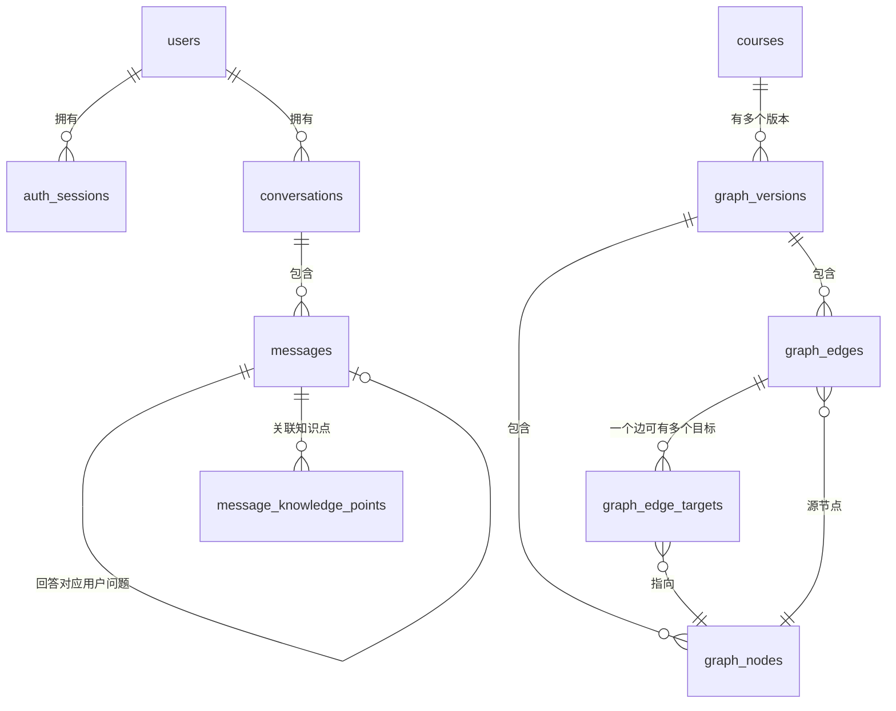

# 学生端数据与接口设计

> 本文是学生端账号、聊天历史与数据模型的设计结论。完整 DDL 以实现为准：
> [`src/schema.py`](../../src/schema.py)；分阶段实施记录见
> [学生端实施计划.md](学生端实施计划.md)。
> 当前 schema 已从阶段 1 的 11 张表扩展到 14 张：新增视频 3 张表、附件表、
> `users.avatar` 等；本文保留核心设计，新增字段不逐一展开。

---

## 1. 设计结论

| 主题 | 结论 |
|---|---|
| 账号 | 用户名 + 密码；不收集手机号/邮箱；用户名大小写不敏感唯一 |
| 角色 | `student` / `teacher` / `admin`；注册接口固定创建 `student`，老师/管理员只能后台脚本创建 |
| 密码 | 只存 scrypt 哈希（含随机盐和参数），绝不存明文，不写日志 |
| 登录凭证 | 服务端生成不透明随机令牌；客户端用 `Authorization: Bearer <token>`；服务端只存令牌 SHA-256 |
| 传输 | 生产必须 HTTPS；本地开发可用 HTTP，但真实账号公网测试必须 HTTPS |
| 游客 | 未登录可调用 `/api/ask`，但**不写数据库**；登录后才保存 |
| 会话 | 一个学生多个会话；一个会话多轮问答；历史列表按会话展示 |
| 多轮 | MVP 只把多轮问答分组保存在同一会话，**不把前几轮传给模型** |
| 数据库 | SQLite；用户/会话/消息用文本 UUID；图谱节点/边用整数主键；版本化迁移 |
| 课程/图谱 | 课程 → 多个图谱版本；同一课程同一范围只启用一个版本；助手消息记录本次图谱版本 |
| 删除 | 会话默认软删除；账号删除/匿名化由后台脚本执行；MVP 不自动清理 |
| API | 保持 `/api/ask` 游客兼容；新增 `/api/auth/*`、`/api/conversations*` |
| 扩展 | 表结构按 PostgreSQL 可迁移方式设计；老师/班级、DuckDB 只预留结构 |

---

## 2. 范围与非目标

**覆盖：** 学生注册/登录/当前用户/退出；游客问答不落库；登录学生创建会话、提问、
查看自己的会话与消息、软删除；后端只信 Bearer 身份；SQLite 表/索引/时间/保留策略；
课程与图谱版本关联；为 PostgreSQL/老师端预留扩展。

**不做：** 老师端页面、班级/作业/考试；DuckDB 报表；短信/邮箱验证码、找回密码、
OAuth、多因素；消息编辑、流式输出（语音/图片/附件已在后续功能中实现，见 README）；
多课程选择页；自动清理与自助注销。

---

## 3. 角色与权限

| 角色 | 用途 | 创建方式 |
|---|---|---|
| `student` | 学生端正常用户 | 自助注册，接口强制写入 |
| `teacher` | 后续查看班级/分析 | 后台脚本创建，无 HTTP 注册入口 |
| `admin` | 运维/数据管理 | 后台脚本创建，无 HTTP 入口 |

| 能力 | 游客 | student | teacher | admin |
|---|---|---|---|---|
| `POST /api/ask` | 可以，不落库 | 可以，可落库 | 可以 | 可以 |
| 注册/登录 | 可以 | 可以 | 不开放注册 | 不开放注册 |
| 查看/删除自己的会话 | 不可以 | 可以 | 可以 | 可以 |
| 查看别人的会话 | 不可以 | 不可以 | MVP 不可以 | MVP 不通过 HTTP 提供 |

> `teacher` 在 MVP 中只预留角色和登录，不自动获得查看所有学生会话的权限。

---

## 4. 领域模型

- 用户 ↔ 登录会话：多设备，各自独立撤销。
- 用户 ↔ 会话：会话只属于一个学生。
- 课程 ↔ 图谱版本：同课程同范围只启用一个；消息记录所用版本，历史答案可追溯。
- 会话 ↔ 消息：用户问题 `role='user'`，助手回答 `role='assistant'`，用
  `reply_to_message_id` 关联。
- 消息 ↔ 知识点：`messages` 存 JSON 快照用于原样展示；`message_knowledge_points`
  拆表用于统计（提问次数、拒答率、前置缺口排行）。

---

## 5. 数据模型

### 5.1 通用约定

| 项 | 约定 |
|---|---|
| 主键 | 用户/会话/消息用 32 位十六进制 UUID 文本；课程/图谱版本用可读文本 id；图谱节点/边用整数 |
| 时间 | UTC ISO 8601 文本，`YYYY-MM-DDTHH:MM:SS.sssZ`；API 返回同格式 |
| 布尔 | SQLite 整数 `0/1` + `CHECK` |
| JSON | 列名以 `_json` 结尾；API 层转换为对象 |
| 外键 | 每个连接 `PRAGMA foreign_keys=ON` |
| 并发 | WAL + `busy_timeout=5000`；短事务 |
| 迁移 | 只通过 `schema_migrations` 版本化迁移；不在启动时隐式改表 |
| 秘密 | 只存密码哈希、令牌哈希；不存明文密码/令牌/API Key |

### 5.2 表清单

| 表 | 作用 |
|---|---|
| `schema_migrations` | 已执行迁移版本 |
| `users` | 学生/老师/管理员账号（当前含 `avatar`） |
| `auth_sessions` | 登录令牌哈希、过期与撤销 |
| `courses` | 课程（如数学） |
| `graph_versions` | 图谱版本与来源 |
| `graph_nodes` | 某版本节点 |
| `graph_edges` | 某版本边 |
| `graph_edge_targets` | 边的一个或多个目标（统一处理标量与列表 target） |
| `conversations` | 学生聊天会话 |
| `messages` | 用户问题/助手回答 |
| `message_knowledge_points` | 助手回答关联知识点 |
| `videos` / `knowledge_point_videos` / `video_candidates` | 后续视频功能（当前 schema） |
| `attachments` | 后续附件功能（当前 schema） |

### 5.3 关键约束（摘要）

- `users.username`：`COLLATE NOCASE` 唯一；`display_name` 可重名；注册强制
  `role='student'`、`status='active'`。
- `auth_sessions.token_hash`：唯一；`(user_id, expires_at)`、`(expires_at)` 索引。
- `graph_versions`：`(course_id, active_slot) WHERE is_active=1` 唯一；原始 JSON 不删除、不覆盖。
- `graph_nodes`：`UNIQUE(graph_version_id, node_key)`；`properties_json` 完整保存。
- `graph_edges`：`UNIQUE(graph_version_id, source_edge_index)`；目标统一放
  `graph_edge_targets`，避免漏掉 `tests_concept`/`tests_skill` 的列表 target。
- `conversations`：`UNIQUE(id, user_id)`；`(user_id, deleted_at, last_message_at DESC, id DESC)` 分页；
  `last_message_at` 非空。
- `messages`：复合外键 `(conversation_id, user_id)` 防越权；`UNIQUE(user_id, client_request_id)`
  重试去重；`(conversation_id, created_at, id)` 分页；失败回答可 `content=NULL`、
  `status='failed'`、带 `error_code`。
- `message_knowledge_points`：主键 `(message_id, relation, node_key, ordinal)`；
  `relation` 取 `body` / `prerequisite_required` / `prerequisite_suggested` / `consolidation`。

> 完整建表、索引、迁移版本以 [`src/schema.py`](../../src/schema.py) 为准。

---

## 6. 注册与密码

- 用户名：3–32 位 ASCII 字母/数字/下划线，大小写不敏感；展示名可中文，1–32 字符。
- 密码：8–128 位，不做强制大小写/符号组合；不 trim、不改写。
- 注册接口忽略/拒绝客户端传来的 `role`、`status`、`id`、`password_hash`，固定
  `student`/`active`。
- 密码用 `hashlib.scrypt`（N=32768, r=8, p=1）加随机盐；只存哈希。
- 注册/登录失败限流：默认注册 5 次/小时/IP，登录失败 10 次/15 分钟/IP+用户名。
- 无手机号/邮箱，MVP 不支持自助找回密码；后台脚本重置。

---

## 7. 令牌与前端存储

- 令牌格式 `ikgr_<随机>`；数据库只存 SHA-256；默认 30 天绝对过期，不自动续期。
- 退出只撤销当前设备；服务端检查未撤销、未过期、`status='active'`。
- 前端存储键：`ikgr.auth.token`、`ikgr.auth.user`；退出/401 清除。
- H5 令牌可被 XSS 读取：禁止 `v-html` 渲染用户内容，保持依赖更新，生产用 HTTPS。
- App 端同样不保存密码。

---

## 8. API 设计

### 8.1 通用约定

- 基础路径 `/api`；JSON UTF-8；受保护接口要求 `Authorization: Bearer <token>`。
- 时间 ISO 8601 UTC；ID 为字符串，不假设递增；游标分页，`next_cursor` 无更多为 `null`。
- 新接口拒绝未知字段；`/api/ask` 为兼容旧客户端保留宽松处理，但**永远忽略**请求里的 `user_id`。
- 错误统一为 `{"error":{"code","message","details","request_id"}}`。

### 8.2 接口总览

| 方法 | 路径 | 认证 | 作用 |
|---|---|---|---|
| POST | `/api/auth/register` | 否 | 注册并自动登录 |
| POST | `/api/auth/login` | 否 | 登录 |
| GET | `/api/auth/me` | 是 | 当前用户 |
| POST | `/api/auth/logout` | 是 | 撤销当前令牌 |
| GET | `/api/conversations` | 是 | 会话列表（游标分页） |
| POST | `/api/conversations` | 是 | 创建空会话 |
| GET | `/api/conversations/{id}` | 是 | 会话详情 |
| PATCH | `/api/conversations/{id}` | 是 | 修改标题（可选） |
| DELETE | `/api/conversations/{id}` | 是 | 软删除会话 |
| GET | `/api/conversations/{id}/messages` | 是 | 消息分页 |
| POST | `/api/ask` | 可选 | 问答；游客不落库，登录可落库 |
| GET | `/api/courses` | 可选 | 课程列表（MVP 只返回数学） |

> 当前还实现了 `/api/transcribe`、`/api/attachments/*`、`/api/videos`、
> `/api/check-answer`、`/api/knowledge/{id}`、`PUT /api/auth/profile` 等，
> 见 README 与 `/docs`（Swagger）。

### 8.3 认证接口

| 接口 | 请求要点 | 成功 | 主要错误 |
|---|---|---|---|
| `POST /api/auth/register` | `username`、`password`、`display_name?` | `201` 令牌 + 用户 | `409 USERNAME_TAKEN`、`422 VALIDATION_ERROR`、`429 RATE_LIMITED` |
| `POST /api/auth/login` | `username`、`password` | `200` 令牌 + 用户 | `401 INVALID_CREDENTIALS`、`403 ACCOUNT_DISABLED`、`429` |
| `GET /api/auth/me` | Bearer | `200` 用户 | `401 UNAUTHORIZED` / `TOKEN_EXPIRED` |
| `POST /api/auth/logout` | Bearer | `204` | 幂等，重复调用仍 204 |

### 8.4 会话与消息

- 列表：`GET /api/conversations?limit=20&cursor=...`，只返回当前用户、未删除会话；
  按 `last_message_at DESC, id DESC`；`limit` 默认 20、最大 50。
- 创建：`POST /api/conversations`，`course_id` 默认 `math`，`title` 默认“新对话”。
- 详情：只查 `id=? AND user_id=当前用户 AND deleted_at IS NULL`；找不到统一
  `404 CONVERSATION_NOT_FOUND`（不区分不存在/别人的）。
- 消息：`GET /api/conversations/{id}/messages?limit=50&cursor=...`；返回最新一页，
  `items` 内按时间正序；`next_cursor` 指向更早；失败回答也返回，`status='failed'`。
- 删除：`DELETE /api/conversations/{id}` 写 `deleted_at` 软删除；重复删除 204。

### 8.5 `/api/ask` 认证行为

| Authorization | `conversation_id` | 行为 |
|---|---|---|
| 无 | 无 | 游客问答；不写库；`persisted=false` |
| 无 | 有 | `401 AUTH_REQUIRED` |
| 有效 | 有 | 校验会话属于当前用户，追加两条消息 |
| 有效 | 无 | 自动建会话并追加；返回新 `conversation_id` |
| 无效/过期 | 任意 | `401`，**不降级为游客** |

登录落库时响应增加 `conversation_id`、`user_message_id`、`assistant_message_id`；
失败时写入 `status='failed'` 的助手消息并返回 502；`client_request_id` 用于重试去重。

### 8.6 错误码

| HTTP | code | 场景 |
|---|---|---|
| 400 | `BAD_REQUEST` | 参数组合不合法 |
| 401 | `UNAUTHORIZED` / `TOKEN_EXPIRED` / `AUTH_REQUIRED` / `INVALID_CREDENTIALS` | 认证失败 |
| 403 | `FORBIDDEN` | 角色无权 |
| 404 | `CONVERSATION_NOT_FOUND` | 会话不存在或不属于当前用户 |
| 409 | `USERNAME_TAKEN` | 用户名重复 |
| 422 | `VALIDATION_ERROR` | 字段校验失败 |
| 429 | `RATE_LIMITED` | 触发限流，带 `Retry-After` |
| 500 | `INTERNAL_ERROR` | 未预期错误，不返回堆栈 |
| 502 | `UPSTREAM_ERROR` | 上游模型失败 |

### 8.7 授权规则

1. 身份只从 `Authorization` 解析，**禁止**从 query/body 读 `user_id`。
2. 会话查询一律带 `user_id=当前用户`；消息先验证会话归属。
3. 访问别人的会话返回 `404`，不返回 `403`（避免泄露存在性）。
4. 复合外键 `(conversation_id, user_id)` 是第二道防线，应用层仍是第一道。
5. 令牌必须同时满足：未撤销、未过期、用户 `status='active'`。
6. 老师/管理员接口用独立 `require_role`；不要用前端隐藏按钮代替后端授权。
7. 日志只记用户 id、请求 id、状态码、耗时；不记密码、令牌、完整聊天内容。

---

## 9. 时间、索引与数据保留

- 时间统一 UTC；服务端用 `datetime.now(timezone.utc)`，不依赖客户端时间。
- 主要索引：`users(username)`、`auth_sessions(token_hash)`、`(user_id, expires_at)`、
  `(expires_at)`、`conversations(user_id, deleted_at, last_message_at DESC, id DESC)`、
  `messages(conversation_id, created_at, id)`、`UNIQUE(user_id, client_request_id)`、
  `message_knowledge_points(graph_version_id, node_key)`，以及图谱查询索引。
- 会话软删除；消息随会话保留；令牌过期/撤销后保留一段时间用于审计；聊天内容不写普通日志。
- 游客问答完全不落库；账号删除由后台脚本撤销令牌、`status='deleted'`、匿名化用户名/展示名。
- 备份放 `data/app/backups/`，限制权限，不提交 Git、不发公开网盘。

---

## 10. 扩展方向

| 方向 | 预留方式 |
|---|---|
| PostgreSQL | UUID→`uuid`、INTEGER→identity、ISO 文本→`timestamptz`、`*_json`→`jsonb`；SQL 集中仓储层 |
| 老师/班级 | 新增 `classes`、`class_members`、`class_courses`、`assignments`；按班级成员授权，不给 teacher 全局读取 |
| DuckDB 分析 | nightly 导出 Parquet/CSV（匿名化），不直连在线 SQLite；不导出密码/令牌哈希 |
| 多课程/版本 | `courses` + `graph_versions` 已支持；同课程同 `active_slot` 只一个启用版本 |
| 认证升级 | 令牌有效期/刷新令牌可配置；未来可加邮箱/管理员重置、Redis 集中限流 |

---

## 11. 安全边界

- **HTTPS 是生产前提**；本地 HTTP 只用测试账号。
- H5 令牌可被 XSS 读取：禁止 `v-html` 渲染用户内容、配置 CSP、保持依赖更新。
- SQLite 单写者：当前单 uvicorn + WAL 足够；多 worker/多机前迁移 PostgreSQL。
- 内存限流重启清零、多进程不共享，只作基础防滥用。
- 无邮箱/短信，无法自助找回密码；无多因素认证。
- CORS 必须收紧为白名单；Bearer 场景不启用 Cookie 凭证。
- 仓库只放占位符；生产密钥只在服务器 `.env`；日志/备份按敏感数据管理。

---

## 12. 已确认的业务规则

1. 用户名 3–32 位 ASCII 字母/数字/下划线，大小写不敏感；展示名允许中文。
2. 密码 8–128 位，不强制组合；不提供自助找回，只能后台重置。
3. 令牌 30 天绝对过期，不自动续期；多设备；退出只撤销当前设备。
4. “多轮”只分组保存，不把前几轮传给模型。
5. 游客完全不落库；游客带 `conversation_id` 返回 401；不支持游客转正补历史。
6. 会话软删除；学生不能自助注销；账号删除/匿名化由后台脚本执行；MVP 不自动清理。
7. MVP 只启用数学；导入全量数学图谱 + 五年级下册子图；不做课程选择页。
8. 问题 1–1000 字符；空问题 422；回答按模型返回保存，不额外截断。
