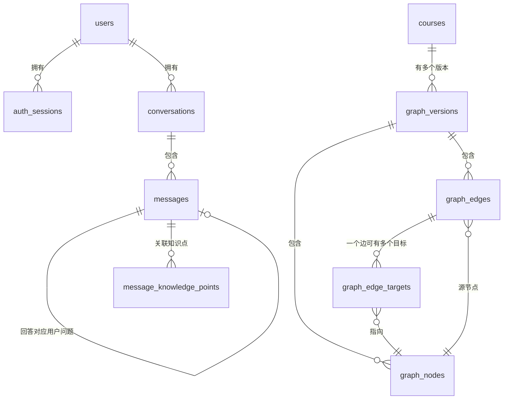

# 学生端数据与接口设计（阶段 1）

> 状态：设计稿，2026-10-28。  
> 依据：[学生端登录与聊天记录实施计划.md](学生端登录与聊天记录实施计划.md) 的阶段 0 盘点结果与已确认决策。  
> 范围：只做设计，不实现功能代码；数据库迁移、认证接口和聊天持久化分别在阶段 2、3、5 实现。  
> 生产前提：公网认证必须走阶段 2.5 完成的 HTTPS；本文不写真实密码、密钥或令牌。

**变更记录**

| 日期 | 来源阶段 | 变更 |
|---|---|---|
| 2026-10-28 | 阶段 2 前用户确认 | 图谱导入范围由「仅五年级下册」扩展为「全量数学 + 五年级下册子图」；建表与图谱数据的增/删/改全部以脚本形式提供（`scripts/migrate.py` 建表、`scripts/import_graph.py` 导入/删除/force 重导）。 |

---

## 1. 设计结论摘要

| 主题 | 结论 |
|---|---|
| 账号 | 用户名 + 密码；不收集手机号/邮箱；用户名大小写不敏感唯一 |
| 角色 | `student` / `teacher` / `admin`；注册接口**固定创建 student**，老师账号只能用后台脚本创建 |
| 密码 | 只存 scrypt 哈希（含随机盐和参数），绝不存明文；不记录到日志 |
| 登录凭证 | 服务端生成不透明随机令牌，客户端用 `Authorization: Bearer <token>` 发送；服务端只存令牌的 SHA-256，支持过期和撤销 |
| 传输 | 生产环境必须 HTTPS；开发环境可本地 HTTP，但带真实凭证的公网测试必须走 HTTPS |
| 游客 | 未登录可调用 `/api/ask`，但**不写任何数据库记录**；登录后才保存 |
| 会话 | 一个学生可有多个会话；一个会话包含多轮问答；历史列表按会话展示 |
| 多轮含义 | MVP 中“多轮”指同一会话里连续保存多次问答；**每次回答仍只基于当前问题，不把前几轮内容传给模型**（后续可扩展） |
| 数据库 | SQLite；用户/会话/消息用文本 UUID；图谱节点/边用整数主键；版本化迁移 |
| 课程/图谱 | 课程 → 多个图谱版本；同一课程同一范围只有一个启用版本；助手消息记录本次使用的图谱版本 |
| 删除 | 会话默认软删除；账号删除/匿名化由后台脚本执行；MVP 不做自动清理 |
| API | 保持现有 `POST /api/ask` 游客用法兼容；新增 `/api/auth/*` 和 `/api/conversations*` |
| 扩展 | 表结构按 PostgreSQL 可迁移方式设计；老师/班级、DuckDB 分析只预留结构，不在 MVP 实现 |

---

## 2. MVP 范围与非目标

### 2.1 本阶段设计覆盖的 MVP

- 学生自助注册、登录、查询当前用户、退出登录。
- 未登录游客可问答，但不保存历史。
- 已登录学生可创建会话、发送问题、查看自己的会话列表和消息历史、删除自己的会话。
- 后端只根据登录凭证判断用户身份，绝不信任客户端传来的 `user_id`。
- SQLite 表结构、索引、时间字段、数据保留策略。
- 课程/图谱版本与消息的关联，保证历史答案可追溯。
- 为 PostgreSQL、老师/班级、DuckDB 分析预留扩展方式。

### 2.2 明确不做（后续阶段或不在本项目范围）

- 老师端页面、老师自助注册、班级管理、作业/考试。
- DuckDB 分析管道和可视化报表。
- 短信/邮箱验证码、找回密码、OAuth、第三方登录、多因素认证。
- 语音输入、图片/附件消息、消息编辑、实时流式输出。
- 多课程选择页面、课程购买/权限。
- 自动清理历史数据、账号自助注销页面。

---

## 3. 角色与权限

### 3.1 角色定义

| 角色 | 用途 | 创建方式 |
|---|---|---|
| `student` | 学生端正常用户 | 学生自助注册，接口强制写入 `student` |
| `teacher` | 后续查看班级/分析 | **只能**由服务器上的后台脚本创建，不开放任何 HTTP 注册入口 |
| `admin` | 运维/数据管理 | 只能由后台脚本创建，不开放 HTTP 入口 |

数据库对 `role` 加 `CHECK` 约束，但约束只保证取值合法；真正的“注册只能创建 student”由注册接口在服务端硬编码，客户端传 `role` 会被忽略或拒绝。

### 3.2 权限矩阵（MVP）

| 能力 | 游客 | student | teacher | admin |
|---|---|---|---|---|
| `POST /api/ask` 问答 | 可以，不落库 | 可以，可落库 | 可以（后续可限制） | 可以 |
| 注册/登录 | 可以 | 可以 | 不开放注册 | 不开放注册 |
| 查看/删除自己的会话 | 不可以 | 可以 | 可以 | 可以 |
| 查看别人的会话 | 不可以 | 不可以 | MVP 不可以 | MVP 不通过 HTTP 提供 |
| 老师/班级分析 | 不可以 | 不可以 | 后续阶段 | 后续阶段 |

> 老师角色在 MVP 中只预留数据结构和登录能力，不提供任何额外接口；不要因为角色是 teacher 就自动获得查看所有学生会话的权限。后续老师分析应基于班级成员关系和聚合数据，另做隐私设计。

---

## 4. 领域模型与关系



### 4.1 关系说明

- **用户与登录会话**：一个用户可以有多条登录会话（手机、H5、多设备）；退出只撤销当前令牌，不影响其他设备。
- **用户与会话**：一个学生拥有多个聊天会话；会话只能属于一个学生。
- **课程与图谱版本**：一门课程（如数学）可以有多个图谱版本；同一课程、同一范围（全学科/某册）同时只启用一个版本。
- **会话与消息**：一个会话包含多条消息；用户问题是一条 `role='user'` 消息，助手回答是一条 `role='assistant'` 消息，回答通过 `reply_to_message_id` 指向对应问题。
- **消息与知识点**：助手消息可以把本体知识点、必需/建议前置、巩固延伸拆到 `message_knowledge_points`，便于后续统计和 DuckDB 分析；同时消息本身保留 JSON 快照，便于原样展示。
- **图谱版本与消息**：助手消息记录本次回答问题使用的图谱版本（以及诊断用的全量版本），即使以后图谱升级，历史答案仍可追溯。

---

## 5. 数据模型（SQLite）

### 5.1 通用约定

| 项 | 约定 |
|---|---|
| 主键 | `users`、`auth_sessions`、`conversations`、`messages` 使用 32 位十六进制 UUID 文本；`courses`、`graph_versions` 使用可读文本 id；`graph_nodes`、`graph_edges` 使用整数主键 |
| 时间 | 数据库存 UTC ISO 8601 文本，格式 `YYYY-MM-DDTHH:MM:SS.sssZ`；API 返回同样格式；不使用本地时区 |
| 布尔 | SQLite 用整数 `0/1`，并加 `CHECK` 约束 |
| JSON | 列名以 `_json` 结尾，存合法 JSON 文本；API 层转换为对象返回 |
| 外键 | 每个连接执行 `PRAGMA foreign_keys=ON`；应用启动时也检查 |
| 并发 | `PRAGMA journal_mode=WAL`；`PRAGMA busy_timeout=5000`；写操作使用短事务 |
| 命名 | 表和列统一 snake_case；索引 `ix_`，唯一索引 `ux_`，外键 `fk_` |
| 迁移 | 只通过 `schema_migrations` 版本化迁移建表/改表；不在启动时隐式改结构 |
| 秘密 | 数据库只保存密码哈希和令牌哈希；不保存明文密码、明文令牌、Qwen 密钥 |

### 5.2 表清单

| 表 | 作用 |
|---|---|
| `schema_migrations` | 记录已执行的迁移版本，保证重复执行安全 |
| `users` | 学生/老师/管理员账号 |
| `auth_sessions` | 登录令牌（只存哈希）、过期和撤销状态 |
| `courses` | 课程，如数学 |
| `graph_versions` | 图谱数据集版本及来源信息 |
| `graph_nodes` | 某图谱版本的节点 |
| `graph_edges` | 某图谱版本的边（源、类型、属性） |
| `graph_edge_targets` | 边的一个或多个目标；用于统一处理标量 target 和 `target_name_to_ids` 列表 |
| `conversations` | 学生的一次聊天会话 |
| `messages` | 会话中的用户问题/助手回答 |
| `message_knowledge_points` | 助手回答关联的知识点（便于分析） |

### 5.3 关键字段设计

#### `users`（用户）

| 字段 | 类型 | 约束/说明 |
|---|---|---|
| `id` | TEXT | 主键，UUID hex |
| `username` | TEXT | 登录名，`COLLATE NOCASE` 唯一；建议 3–32 位 ASCII 字母/数字/下划线 |
| `display_name` | TEXT | 展示名，可中文，1–32 字符；注册时可省略，默认等于用户名 |
| `password_hash` | TEXT | scrypt 哈希字符串，包含算法、参数、盐和哈希；禁止明文 |
| `role` | TEXT | `student` / `teacher` / `admin`，默认 `student` |
| `status` | TEXT | `active` / `disabled` / `deleted`；登录和鉴权只接受 `active` |
| `created_at` / `updated_at` | TEXT | UTC 时间 |
| `last_login_at` | TEXT | 最近成功登录时间，可空 |

索引/约束：

- `UNIQUE(username)`（`COLLATE NOCASE`，仅 ASCII 大小写不敏感）。
- 不对 `display_name` 做唯一约束，允许重名。
- 注册接口强制 `role='student'`、`status='active'`。

#### `auth_sessions`（登录会话/令牌）

| 字段 | 类型 | 约束/说明 |
|---|---|---|
| `id` | TEXT | 主键，UUID hex |
| `user_id` | TEXT | 外键 → `users.id`，`ON DELETE CASCADE` |
| `token_hash` | TEXT | 令牌的 SHA-256 十六进制；**不存明文令牌**；唯一 |
| `created_at` | TEXT | 签发时间 |
| `expires_at` | TEXT | 绝对过期时间（默认 30 天） |
| `revoked_at` | TEXT | 退出/管理员撤销时间，可空 |
| `last_used_at` | TEXT | 最近使用时间，可空（低频更新） |
| `user_agent` | TEXT | 客户端标识，截断到 255 字符，可空 |
| `ip_hash` | TEXT | 可选：IP 的加盐哈希，不存原始 IP |

索引：

- `UNIQUE(token_hash)`。
- `(user_id, expires_at)`：按用户撤销/清理。
- `(expires_at)`：定期清理过期令牌。

#### `courses`（课程）

| 字段 | 类型 | 说明 |
|---|---|---|
| `id` | TEXT | 主键，如 `math` |
| `code` | TEXT | 唯一短代码，如 `math` |
| `name` | TEXT | 如“小学数学” |
| `subject` | TEXT | 如 `math` |
| `status` | TEXT | `active` / `archived` |
| `created_at` / `updated_at` | TEXT | UTC 时间 |

#### `graph_versions`（图谱版本）

| 字段 | 类型 | 说明 |
|---|---|---|
| `id` | TEXT | 主键，如 `math_5b_rjb@2026-10-17` |
| `course_id` | TEXT | 外键 → `courses.id`，`ON DELETE RESTRICT` |
| `scope` | TEXT | `subject_full`（全学科）/ `book`（某册）/ `custom` |
| `book_id` | TEXT | 册 id，如 `math_5b_rjb`；`scope='book'` 时必填 |
| `active_slot` | TEXT | 启用槽位，如 `subject_full`、`book:math_5b_rjb`；用于“同课程同范围只启用一个” |
| `dataset_name` | TEXT | 数据集名称，如 `K12-KGraph math` |
| `dataset_version` | TEXT | 数据版本/下载日期 |
| `source_path` | TEXT | 原始 JSON 路径（保留来源） |
| `source_sha256` | TEXT | 原始文件校验和，防止误导入 |
| `imported_at` | TEXT | 导入时间 |
| `is_active` | INTEGER | 0/1；`1` 表示当前启用 |
| `metadata_json` | TEXT | 额外来源信息（授权、论文版本等） |

索引/约束：

- `CREATE UNIQUE INDEX ux_graph_versions_active_slot ON graph_versions(course_id, active_slot) WHERE is_active = 1;`
- 原始 JSON **不删除、不覆盖**；数据库只是导入副本。

#### `graph_nodes`（图谱节点）

| 字段 | 类型 | 说明 |
|---|---|---|
| `id` | INTEGER | 内部主键 |
| `graph_version_id` | TEXT | 外键 → `graph_versions.id` |
| `node_key` | TEXT | 原始 JSON 的节点 `id`，如 `math_5b_rjb_cpt35` |
| `label` | TEXT | `Book` / `Chapter` / `Section` / `Concept` / `Skill` / `Exercise` |
| `name` | TEXT | 节点名称 |
| `properties_json` | TEXT | 原始 `properties` 完整保存（definition、aliases、importance 等） |

约束/索引：

- `UNIQUE(graph_version_id, node_key)`：同一版本内节点 id 唯一。
- `(graph_version_id, label)`：按类型筛选。
- `(graph_version_id, name)`：按名称查询/调试。
- 不把 `definition` 等拆成固定列，避免不同节点类型字段差异导致丢属性；需要检索时再建索引或派生表。

#### `graph_edges`（图谱边）

| 字段 | 类型 | 说明 |
|---|---|---|
| `id` | INTEGER | 内部主键 |
| `graph_version_id` | TEXT | 外键 → `graph_versions.id` |
| `source_key` | TEXT | 源节点原始 id |
| `source_name` | TEXT | 原始 `source_name`，可空 |
| `type` | TEXT | 关系类型，如 `prerequisites_for`、`tests_concept` |
| `source_edge_index` | INTEGER | 原 JSON 中边的序号（从 0 或 1 开始由导入器固定），用于溯源和重复导入 |
| `properties_json` | TEXT | 原始 `properties`，以及 `source_stem` 等非核心字段 |

约束/索引：

- `UNIQUE(graph_version_id, source_edge_index)`：同一版本内边序号唯一。
- 复合外键 `(graph_version_id, source_key)` → `graph_nodes(graph_version_id, node_key)`。
- `(graph_version_id, source_key, type)`、`(graph_version_id, type)`。

> 边的目标不放在 `graph_edges.target_key`，而是统一放到 `graph_edge_targets`。这样标量 target 和列表型 target 用同一种结构，不会漏掉 `tests_concept` / `tests_skill`。

#### `graph_edge_targets`（边目标）

| 字段 | 类型 | 说明 |
|---|---|---|
| `edge_id` | INTEGER | 外键 → `graph_edges.id`，`ON DELETE CASCADE` |
| `graph_version_id` | TEXT | 冗余版本 id，用于复合外键和索引 |
| `ordinal` | INTEGER | 原列表中的顺序，从 0 开始 |
| `target_key` | TEXT | 目标节点原始 id |
| `target_name` | TEXT | 目标名称，可空 |

约束/索引：

- 主键 `(edge_id, ordinal)`。
- `UNIQUE(edge_id, target_key)`：同一条边不重复指向同一目标。
- 复合外键 `(graph_version_id, target_key)` → `graph_nodes(graph_version_id, node_key)`。
- `(graph_version_id, target_key)`：反查某知识点被哪些边指向。

#### `conversations`（会话）

| 字段 | 类型 | 说明 |
|---|---|---|
| `id` | TEXT | 主键，UUID hex |
| `user_id` | TEXT | 外键 → `users.id`，`ON DELETE RESTRICT` |
| `course_id` | TEXT | 外键 → `courses.id`；MVP 固定为数学 |
| `title` | TEXT | 会话标题；默认取第一个问题前 30 个字符，可后续修改 |
| `created_at` | TEXT | 创建时间 |
| `updated_at` | TEXT | 最近更新时间 |
| `last_message_at` | TEXT | 最近消息时间；创建时等于 `created_at`，用于稳定排序 |
| `deleted_at` | TEXT | 软删除时间，可空 |

约束/索引：

- `UNIQUE(id, user_id)`：为消息的复合外键提供目标（防御性设计）。
- `(user_id, deleted_at, last_message_at DESC, id DESC)`：会话列表分页。
- `last_message_at` 不允许 NULL，避免排序时空值处理不一致。

#### `messages`（消息）

| 字段 | 类型 | 说明 |
|---|---|---|
| `id` | TEXT | 主键，UUID hex |
| `conversation_id` | TEXT | 外键 → `conversations.id` |
| `user_id` | TEXT | 冗余的会话所有者；用于越权防御和查询 |
| `role` | TEXT | `user` / `assistant` / `system` |
| `content` | TEXT | 问题或回答文本；失败回答可为 NULL |
| `status` | TEXT | `completed` / `failed` / `pending` |
| `refused` | INTEGER | 0/1，是否拒答 |
| `knowledge_point` | TEXT | 本体知识点名称，可空 |
| `source` | TEXT | 教材出处，可空 |
| `learning_path_json` | TEXT | 学习路径 JSON 快照，可空 |
| `prerequisite_gaps_json` | TEXT | 前置知识缺口 JSON 快照，可空 |
| `graph_version_id` | TEXT | 本次回答主要使用的图谱版本（如 5b 子图版本） |
| `context_graph_version_id` | TEXT | 前置诊断使用的全量图谱版本 |
| `reply_to_message_id` | TEXT | 助手消息指向对应的用户消息，可空 |
| `client_request_id` | TEXT | 客户端生成的请求 id，用于重试去重；可空 |
| `error_code` | TEXT | 失败时的稳定错误码，可空 |
| `error_message` | TEXT | 失败时的用户可读信息（不含堆栈/密钥），可空 |
| `latency_ms` | INTEGER | 回答耗时，可空 |
| `created_at` / `updated_at` | TEXT | UTC 时间 |

约束/索引：

- 复合外键 `(conversation_id, user_id)` → `conversations(id, user_id)`，`ON DELETE CASCADE`；这样即使应用层漏了检查，数据库也不会让消息挂到别人的会话上。
- `reply_to_message_id` 简单外键 → `messages(id)`，`ON DELETE SET NULL`；应用层还要校验同一会话。
- `UNIQUE(user_id, client_request_id) WHERE client_request_id IS NOT NULL`：同一学生重复提交同一请求时可用于去重。
- `(conversation_id, created_at, id)`：消息分页。
- `(conversation_id, role, created_at)`：可选，用于快速取最后一轮。

#### `message_knowledge_points`（消息关联知识点）

| 字段 | 类型 | 说明 |
|---|---|---|
| `message_id` | TEXT | 外键 → `messages.id`，`ON DELETE CASCADE` |
| `graph_version_id` | TEXT | 知识点所属图谱版本 |
| `node_key` | TEXT | 节点原始 id |
| `node_name` | TEXT | 节点名称快照 |
| `relation` | TEXT | `body` / `prerequisite_required` / `prerequisite_suggested` / `consolidation` |
| `ordinal` | INTEGER | 展示顺序 |

主键 `(message_id, relation, node_key, ordinal)`；索引 `(graph_version_id, node_key)`。

> 为什么既在 `messages` 存 JSON，又拆这张表？JSON 负责“原样还原界面”，拆表负责后续统计（某个知识点被问了多少次、拒答率、前置缺口排行）。MVP 可以先只写 JSON，拆表在阶段 5 实现；但只要表结构在，后续不用改库。

### 5.4 完整建表草案（供阶段 2 参考）

> 以下是设计草案，不是本阶段执行的迁移文件。阶段 2 应把它拆成版本化 migration，并补充导入脚本、备份和回滚。

```sql
PRAGMA foreign_keys = ON;
PRAGMA journal_mode = WAL;
PRAGMA busy_timeout = 5000;

CREATE TABLE schema_migrations (
    version     INTEGER PRIMARY KEY,
    name        TEXT NOT NULL,
    applied_at  TEXT NOT NULL
);

CREATE TABLE users (
    id              TEXT PRIMARY KEY,
    username        TEXT NOT NULL COLLATE NOCASE,
    display_name    TEXT NOT NULL,
    password_hash   TEXT NOT NULL,
    role            TEXT NOT NULL DEFAULT 'student'
                    CHECK (role IN ('student', 'teacher', 'admin')),
    status          TEXT NOT NULL DEFAULT 'active'
                    CHECK (status IN ('active', 'disabled', 'deleted')),
    created_at      TEXT NOT NULL,
    updated_at      TEXT NOT NULL,
    last_login_at   TEXT,
    CONSTRAINT uq_users_username UNIQUE (username)
);

CREATE TABLE auth_sessions (
    id              TEXT PRIMARY KEY,
    user_id         TEXT NOT NULL REFERENCES users(id) ON DELETE CASCADE,
    token_hash      TEXT NOT NULL,
    created_at      TEXT NOT NULL,
    expires_at      TEXT NOT NULL,
    revoked_at      TEXT,
    last_used_at    TEXT,
    user_agent      TEXT,
    ip_hash         TEXT,
    CONSTRAINT uq_auth_sessions_token_hash UNIQUE (token_hash)
);
CREATE INDEX ix_auth_sessions_user   ON auth_sessions(user_id, expires_at);
CREATE INDEX ix_auth_sessions_expiry ON auth_sessions(expires_at);

CREATE TABLE courses (
    id          TEXT PRIMARY KEY,
    code        TEXT NOT NULL,
    name        TEXT NOT NULL,
    subject     TEXT NOT NULL,
    status      TEXT NOT NULL DEFAULT 'active'
                CHECK (status IN ('active', 'archived')),
    created_at  TEXT NOT NULL,
    updated_at  TEXT NOT NULL,
    CONSTRAINT uq_courses_code UNIQUE (code)
);

CREATE TABLE graph_versions (
    id              TEXT PRIMARY KEY,
    course_id       TEXT NOT NULL REFERENCES courses(id) ON DELETE RESTRICT,
    scope           TEXT NOT NULL
                    CHECK (scope IN ('subject_full', 'book', 'custom')),
    book_id         TEXT,
    active_slot     TEXT NOT NULL,
    dataset_name    TEXT NOT NULL,
    dataset_version TEXT,
    source_path     TEXT NOT NULL,
    source_sha256   TEXT NOT NULL,
    imported_at     TEXT NOT NULL,
    is_active       INTEGER NOT NULL DEFAULT 0
                    CHECK (is_active IN (0, 1)),
    metadata_json   TEXT NOT NULL DEFAULT '{}',
    CHECK (scope <> 'book' OR book_id IS NOT NULL)
);
CREATE UNIQUE INDEX ux_graph_versions_active_slot
    ON graph_versions(course_id, active_slot)
    WHERE is_active = 1;

CREATE TABLE graph_nodes (
    id                 INTEGER PRIMARY KEY,
    graph_version_id   TEXT NOT NULL REFERENCES graph_versions(id)
                       ON DELETE RESTRICT,
    node_key           TEXT NOT NULL,
    label              TEXT NOT NULL,
    name               TEXT NOT NULL,
    properties_json    TEXT NOT NULL DEFAULT '{}',
    CONSTRAINT uq_graph_nodes_key UNIQUE (graph_version_id, node_key)
);
CREATE INDEX ix_graph_nodes_label ON graph_nodes(graph_version_id, label);
CREATE INDEX ix_graph_nodes_name  ON graph_nodes(graph_version_id, name);

CREATE TABLE graph_edges (
    id                 INTEGER PRIMARY KEY,
    graph_version_id   TEXT NOT NULL REFERENCES graph_versions(id)
                       ON DELETE RESTRICT,
    source_key         TEXT NOT NULL,
    source_name        TEXT,
    type               TEXT NOT NULL,
    source_edge_index  INTEGER NOT NULL,
    properties_json    TEXT NOT NULL DEFAULT '{}',
    CONSTRAINT uq_graph_edges_source_index
        UNIQUE (graph_version_id, source_edge_index),
    CONSTRAINT fk_graph_edges_source
        FOREIGN KEY (graph_version_id, source_key)
        REFERENCES graph_nodes(graph_version_id, node_key)
        ON DELETE RESTRICT
);
CREATE INDEX ix_graph_edges_source ON graph_edges(graph_version_id, source_key, type);
CREATE INDEX ix_graph_edges_type   ON graph_edges(graph_version_id, type);

CREATE TABLE graph_edge_targets (
    edge_id            INTEGER NOT NULL REFERENCES graph_edges(id) ON DELETE CASCADE,
    graph_version_id   TEXT NOT NULL REFERENCES graph_versions(id) ON DELETE RESTRICT,
    ordinal            INTEGER NOT NULL,
    target_key         TEXT NOT NULL,
    target_name        TEXT,
    PRIMARY KEY (edge_id, ordinal),
    CONSTRAINT uq_graph_edge_targets UNIQUE (edge_id, target_key),
    CONSTRAINT fk_graph_edge_targets_target
        FOREIGN KEY (graph_version_id, target_key)
        REFERENCES graph_nodes(graph_version_id, node_key)
        ON DELETE RESTRICT
);
CREATE INDEX ix_graph_edge_targets_target
    ON graph_edge_targets(graph_version_id, target_key);

CREATE TABLE conversations (
    id               TEXT PRIMARY KEY,
    user_id          TEXT NOT NULL REFERENCES users(id) ON DELETE RESTRICT,
    course_id        TEXT NOT NULL REFERENCES courses(id) ON DELETE RESTRICT,
    title            TEXT NOT NULL,
    created_at       TEXT NOT NULL,
    updated_at       TEXT NOT NULL,
    last_message_at  TEXT NOT NULL,
    deleted_at       TEXT,
    CONSTRAINT uq_conversations_id_user UNIQUE (id, user_id)
);
CREATE INDEX ix_conversations_user_list
    ON conversations(user_id, deleted_at, last_message_at DESC, id DESC);

CREATE TABLE messages (
    id                        TEXT PRIMARY KEY,
    conversation_id           TEXT NOT NULL,
    user_id                   TEXT NOT NULL,
    role                      TEXT NOT NULL
                              CHECK (role IN ('user', 'assistant', 'system')),
    content                   TEXT,
    status                    TEXT NOT NULL
                              CHECK (status IN ('completed', 'failed', 'pending')),
    refused                   INTEGER NOT NULL DEFAULT 0
                              CHECK (refused IN (0, 1)),
    knowledge_point           TEXT,
    source                    TEXT,
    learning_path_json        TEXT,
    prerequisite_gaps_json    TEXT,
    graph_version_id          TEXT REFERENCES graph_versions(id) ON DELETE RESTRICT,
    context_graph_version_id  TEXT REFERENCES graph_versions(id) ON DELETE RESTRICT,
    reply_to_message_id       TEXT REFERENCES messages(id) ON DELETE SET NULL,
    client_request_id         TEXT,
    error_code                TEXT,
    error_message             TEXT,
    latency_ms                INTEGER,
    created_at                TEXT NOT NULL,
    updated_at                TEXT NOT NULL,
    CONSTRAINT fk_messages_conversation_user
        FOREIGN KEY (conversation_id, user_id)
        REFERENCES conversations(id, user_id)
        ON DELETE CASCADE
);
CREATE INDEX ix_messages_conversation
    ON messages(conversation_id, created_at, id);
CREATE UNIQUE INDEX ux_messages_client_request
    ON messages(user_id, client_request_id)
    WHERE client_request_id IS NOT NULL;

CREATE TABLE message_knowledge_points (
    message_id        TEXT NOT NULL REFERENCES messages(id) ON DELETE CASCADE,
    graph_version_id  TEXT NOT NULL REFERENCES graph_versions(id) ON DELETE RESTRICT,
    node_key          TEXT NOT NULL,
    node_name         TEXT,
    relation          TEXT NOT NULL
                      CHECK (relation IN (
                          'body',
                          'prerequisite_required',
                          'prerequisite_suggested',
                          'consolidation'
                      )),
    ordinal           INTEGER NOT NULL DEFAULT 0,
    PRIMARY KEY (message_id, relation, node_key, ordinal)
);
CREATE INDEX ix_mkp_node
    ON message_knowledge_points(graph_version_id, node_key);
```

### 5.5 与现有 JSON 图谱的映射（阶段 2 实现）

| 原始 JSON | 数据库 |
|---|---|
| `nodes[].id` | `graph_nodes.node_key` |
| `nodes[].label` / `name` / `properties` | `graph_nodes.label` / `name` / `properties_json` |
| `edges[].source` / `source_name` / `type` / `properties` | `graph_edges.source_key` / `source_name` / `type` / `properties_json` |
| `edges[].target`（标量） | 一条 `graph_edge_targets`（`ordinal=0`，`target_name` 取原字段） |
| `edges[].target_name_to_ids[]`（列表） | 多条 `graph_edge_targets`（按列表顺序写 `ordinal`） |
| `edges[].source_stem` 等非核心字段 | 放入 `graph_edges.properties_json` |
| 原始边在数组中的下标 | `graph_edges.source_edge_index` |

实测数量（阶段 0）：

- 全量数学图谱：2711 节点、5273 边；其中标量边 4638 条，特殊边 635 条（`tests_concept` 406 + `tests_skill` 229），特殊边目标行 698 条，**总目标行 5336 条**。
- 五年级下册子图：67 节点、92 边，均为标量边，目标行 92 条。
- 导入校验至少要核对：节点数、边数、目标行数、8 种关系类型、635 条特殊边全部存在、无悬空 source/target。

> 阶段 2 的硬要求：不能只按 `target` 导入。特殊边必须通过 `graph_edge_targets` 展开；导入前后输出计数，失败回滚，原始 JSON 保留。

### 5.6 为什么这样设计（取舍）

1. **文本 UUID vs 自增整数**：用户/会话/消息会在 URL 和前端出现，UUID 不容易被顺序枚举；SQLite 和 PostgreSQL 都能存，迁移简单。代价是索引略大、随机 id 不适合直接排序，所以排序用 `created_at`/`last_message_at` 加 id 兜底。
2. **不透明令牌 + 哈希表 vs JWT**：JWT 无状态、扩展方便，但退出/封禁/改密码后旧令牌仍有效，除非维护黑名单；本项目已有数据库，用随机令牌 + `auth_sessions` 表可以立即撤销、按设备管理、无需管理签名密钥。代价是每次请求多一次数据库查询，当前规模完全可接受。
3. **Bearer 头 vs HttpOnly Cookie**：uni-app 同时覆盖 App 和 H5，App 端 `uni.request` 用 Cookie 跨域/持久化不如显式头直观；Bearer 也不会被浏览器自动附带，天然少一类 CSRF。代价是 H5 存在 XSS 时令牌可被读取，因此必须配合 HTTPS、CSP、不用 `v-html` 渲染用户内容。若以后只做 H5，可以再评估 HttpOnly Cookie。
4. **JSON 快照 + 拆知识点表**：只存 JSON 实现快，但统计困难；只拆表则界面还原容易丢字段。两者都保留，代价是少量冗余，换来实现简单和后续分析能力。
5. **边目标统一拆表**：如果只看标量 `target`，会漏掉 635 条特殊边；统一成 `graph_edge_targets` 后，标量边和列表边走同一套查询，阶段 2 不容易漏数据。
6. **软删除会话**：学生误删后后台仍可恢复，也避免外键和统计断裂；代价是查询都要带 `deleted_at IS NULL`，后续需要清理策略。

---

## 6. 学生注册规则

### 6.1 注册字段

| 字段 | 必填 | 规则（建议值，待确认） |
|---|---|---|
| `username` | 是 | 3–32 位，ASCII 字母/数字/下划线；大小写不敏感唯一；不允许空格和中文 |
| `password` | 是 | 8–128 位，任意字符；不做“必须含大小写/符号”的强制组合；不 trim、不改写 |
| `display_name` | 否 | 1–32 字符，可中文；省略时默认等于 `username`；不做唯一约束 |

服务端行为：

- 忽略/拒绝客户端传来的 `role`、`status`、`id`、`password_hash`；注册结果固定为 `role='student'`、`status='active'`。
- 用户名统一按小写存储或利用 `COLLATE NOCASE` 唯一约束；登录时大小写不敏感。
- 注册成功后直接签发登录令牌（自动登录），避免注册后还要再登录一次。
- 用户名重复返回 `409 USERNAME_TAKEN`；这是注册场景无法完全避免的账号存在性提示，登录接口不泄露账号是否存在。
- 不收集手机号、邮箱、真实姓名、学校、班级；后续班级功能再按需求增加，并单独做隐私说明。

### 6.2 密码处理

- 使用 Python 标准库 `hashlib.scrypt`，默认参数建议 `n=2**15, r=8, p=1, dklen=32`，每个用户 16 字节随机盐，`maxmem` 设为足够值（如 64 MiB）。
- 存储格式示例（示意，不是真实值）：`scrypt$32768$8$1$<base64盐>$<base64哈希>`。
- 校验用 `hmac.compare_digest`；用户不存在时也执行一次等价耗时的假哈希校验，降低通过响应时间判断账号是否存在的可能。
- 登录成功后如果发现哈希参数旧了，可以透明地重新哈希并更新（阶段 3 可选）。
- 不在日志、异常信息、API 响应、前端存储中写入密码。
- 不引入 pepper（可选扩展）；如果以后增加 `AUTH_PEPPER`，必须明确“丢失 pepper 会导致所有密码不可验证”的运维风险。

### 6.3 注册限流与滥用

MVP 建议（阶段 3 实现，单进程可用内存计数器，重启清零）：

- 注册：同一 IP 每小时最多 5 次。
- 登录：同一 IP + 用户名 15 分钟内最多 10 次失败；成功后清零。
- 问答：登录用户每分钟 30 次；游客按 IP 每分钟 10 次。
- 超限返回 `429 RATE_LIMITED` 和 `Retry-After`。

> 单进程内存限流在多 worker/多机部署下不准确；当前 systemd 单进程够用，未来迁移 PostgreSQL/Redis 时再换集中式限流。

---

## 7. 登录凭证与前端存储

### 7.1 令牌生成与校验

1. 登录成功后生成 32 字节随机数：`secrets.token_urlsafe(32)`，加前缀 `ikgr_` 便于识别和日志脱敏。
2. 服务端只保存 `sha256(token)` 的十六进制到 `auth_sessions.token_hash`；明文令牌只在登录/注册响应中返回一次。
3. 客户端后续请求带 `Authorization: Bearer ikgr_...`。
4. 服务端收到请求后：计算 SHA-256 → 按 `token_hash` 查会话 → 检查 `revoked_at IS NULL`、`expires_at > now`、用户 `status='active'` → 得到用户身份。
5. 任何失败都返回 `401`，不区分“没带令牌”“令牌不存在”“令牌过期”“用户被禁用”的对外细节；响应体可用稳定错误码区分过期（`TOKEN_EXPIRED`）以便前端跳登录，但不要泄露账号状态。

### 7.2 有效期、撤销与多设备

- 默认绝对有效期 **30 天**（配置项 `AUTH_TOKEN_TTL_DAYS`），不做自动续期；到期后重新登录。
- 退出登录：`POST /api/auth/logout` 撤销当前令牌（写 `revoked_at`），其他设备不受影响。
- 修改密码/禁用账号/账号删除：撤销该用户全部令牌（阶段 3 实现）。
- 支持同一学生多设备同时登录，每个设备一条 `auth_sessions`。
- 过期/撤销的令牌保留一段时间用于审计，之后由清理任务删除；MVP 可先不自动清理。

### 7.3 uni-app / H5 存储方案

| 环境 | 存储方式 | 说明 |
|---|---|---|
| App（Android/iOS） | `uni.setStorageSync('ikgr.auth.token', token)` | App 沙盒存储，其他应用一般不可读；仍需防止设备被 root/越狱后的读取 |
| H5 | `uni.setStorageSync`（底层 localStorage） | 同源脚本可读；必须防 XSS |
| 内存 | 当前用户对象缓存在 `store`/组件状态 | 页面刷新后从存储恢复，再用 `GET /api/auth/me` 校验 |

建议键名：

- `ikgr.auth.token`：令牌。
- `ikgr.auth.user`：当前用户 JSON（只做展示缓存，不作为授权依据）。
- `ikgr.auth.expires_at`：本地提示用，不作为服务端校验依据。

处理规则：

- **不保存密码**，不保存密码哈希。
- 收到 `401`：清除本地令牌和用户缓存，跳转登录页；不要把过期令牌继续发给后端。
- 退出登录：先调用后端 `logout`，无论成功与否都清除本地令牌（防止本地残留）。
- 游客问答不写入任何本地历史；登录后历史从后端拉取。
- H5 的 XSS 风险：所有用户内容用 Vue 文本插值渲染，禁止 `v-html`；配置 CSP（阶段 2.5/4）；不在 URL、日志、错误上报中携带令牌。
- 未来若要改为 HttpOnly Cookie：需要 `allow_credentials`、明确的 CORS 白名单、`SameSite`/CSRF 防护；当前不采用。

### 7.4 HTTPS 与 CORS

- 生产环境所有认证/聊天请求必须走 `https://<域名>`；HTTP 只用于 301/308 跳转。
- CORS 从环境变量读取白名单（如正式 H5 域名 + 本地开发地址），不再使用 `allow_origins=["*"]`。
- 使用 Bearer 头时 `allow_credentials=False`；允许的请求头至少 `Authorization, Content-Type`。
- App 原生请求不受浏览器 CORS 限制，但仍必须走 HTTPS。
- 不在日志中打印 `Authorization` 头。

---

## 8. API 设计

### 8.1 通用约定

- 基础路径：`/api`；现有 `POST /api/ask` 保持不变。
- 请求/响应：`application/json; charset=utf-8`。
- 认证：受保护接口要求 `Authorization: Bearer <token>`。
- 时间：ISO 8601 UTC，带毫秒和 `Z`，例如 `2026-10-28T08:30:00.000Z`。
- ID：字符串；客户端不要假设它是递增数字。
- 分页：游标分页，`limit` 有上限；返回 `next_cursor`（没有更多时为 `null`）。
- 请求校验：新接口拒绝未知字段（`extra='forbid'`）；`/api/ask` 为兼容旧客户端，保留宽松处理，但**永远忽略**请求里的 `user_id`。
- 错误：统一错误包裹；成功响应保持现有问答字段不变。

### 8.2 接口总览

| 方法 | 路径 | 认证 | 作用 |
|---|---|---|---|
| POST | `/api/auth/register` | 否 | 学生注册并自动登录 |
| POST | `/api/auth/login` | 否 | 学生登录 |
| GET | `/api/auth/me` | 是 | 当前用户信息 |
| POST | `/api/auth/logout` | 是 | 撤销当前令牌 |
| GET | `/api/conversations` | 是 | 会话列表（游标分页） |
| POST | `/api/conversations` | 是 | 创建空会话 |
| GET | `/api/conversations/{id}` | 是 | 会话详情 |
| PATCH | `/api/conversations/{id}` | 是 | 修改标题（可选，MVP 可先不做） |
| DELETE | `/api/conversations/{id}` | 是 | 软删除会话 |
| GET | `/api/conversations/{id}/messages` | 是 | 消息分页 |
| POST | `/api/ask` | 可选 | 问答；游客不落库，登录可落库 |
| GET | `/api/courses` | 可选 | 课程列表（MVP 可只返回数学） |

### 8.3 注册

`POST /api/auth/register`

请求：

```json
{
  "username": "xiaoming",
  "password": "<至少8位的用户密码>",
  "display_name": "小明"
}
```

成功 `201`：

```json
{
  "token": "ikgr_<随机令牌，仅此一次返回>",
  "token_type": "bearer",
  "expires_at": "2026-11-27T08:30:00.000Z",
  "user": {
    "id": "<uuid>",
    "username": "xiaoming",
    "display_name": "小明",
    "role": "student",
    "created_at": "2026-10-28T08:30:00.000Z"
  }
}
```

错误：

- `409 USERNAME_TAKEN`：用户名已存在。
- `422 VALIDATION_ERROR`：用户名/密码/展示名不符合规则。
- `429 RATE_LIMITED`：注册过于频繁。

### 8.4 登录

`POST /api/auth/login`

请求：

```json
{ "username": "xiaoming", "password": "<用户密码>" }
```

成功 `200`：同注册成功响应（令牌 + 用户信息）。

错误：

- `401 INVALID_CREDENTIALS`：统一提示“用户名或密码错误”，不说明是账号不存在还是密码错误。
- `403 ACCOUNT_DISABLED`：账号被禁用（是否暴露该状态待确认；也可统一 401）。
- `429 RATE_LIMITED`。

### 8.5 当前用户

`GET /api/auth/me`（需要 Bearer）

成功 `200`：

```json
{
  "id": "<uuid>",
  "username": "xiaoming",
  "display_name": "小明",
  "role": "student",
  "created_at": "2026-10-28T08:30:00.000Z",
  "last_login_at": "2026-10-28T08:30:00.000Z"
}
```

错误：`401 UNAUTHORIZED` / `TOKEN_EXPIRED`。

### 8.6 退出登录

`POST /api/auth/logout`（需要 Bearer）

成功 `204 No Content`。服务端写 `revoked_at`；重复调用也返回 204（幂等）。

### 8.7 会话列表

`GET /api/conversations?limit=20&cursor=<opaque>`

认证：必须。只返回 `user_id = 当前用户` 且 `deleted_at IS NULL` 的会话。

成功 `200`：

```json
{
  "items": [
    {
      "id": "<uuid>",
      "title": "为什么异分母分数相加要先通分",
      "course_id": "math",
      "created_at": "2026-10-28T08:30:00.000Z",
      "updated_at": "2026-10-28T08:31:00.000Z",
      "last_message_at": "2026-10-28T08:31:00.000Z",
      "message_count": 2
    }
  ],
  "next_cursor": null,
  "has_more": false
}
```

- 默认 `limit=20`，最大 50。
- 按 `last_message_at DESC, id DESC` 排序。
- `cursor` 是不透明字符串（服务端可 base64 编码 `last_message_at|id`），客户端只回传，不解析。
- `message_count` 可选；若做，需注意软删除和性能，MVP 可先不返回或异步统计。

### 8.8 创建会话

`POST /api/conversations`

请求：

```json
{ "course_id": "math", "title": "新对话" }
```

`course_id` 可省略，默认 `math`；`title` 可省略，默认“新对话”。

成功 `201`：

```json
{
  "id": "<uuid>",
  "title": "新对话",
  "course_id": "math",
  "created_at": "2026-10-28T08:30:00.000Z",
  "updated_at": "2026-10-28T08:30:00.000Z",
  "last_message_at": "2026-10-28T08:30:00.000Z",
  "deleted_at": null
}
```

说明：

- 显式创建是为了“新建对话”按钮。
- 也允许登录用户直接调用 `/api/ask` 不带 `conversation_id`，由后端自动建会话（见 8.11），避免前端多一次请求。

### 8.9 会话详情

`GET /api/conversations/{id}`（需要 Bearer）

- 只查 `id = ? AND user_id = 当前用户 AND deleted_at IS NULL`。
- 找到返回会话字段；找不到返回 `404 CONVERSATION_NOT_FOUND`（不区分“不存在”和“是别人的”，避免泄露）。

### 8.10 消息分页

`GET /api/conversations/{id}/messages?limit=50&cursor=<opaque>`

认证与授权：必须；先校验会话属于当前用户。

成功 `200`：

```json
{
  "items": [
    {
      "id": "<uuid>",
      "role": "user",
      "content": "为什么异分母分数相加要先通分",
      "status": "completed",
      "created_at": "2026-10-28T08:30:00.000Z"
    },
    {
      "id": "<uuid>",
      "role": "assistant",
      "content": "……",
      "status": "completed",
      "refused": false,
      "knowledge_point": "异分母分数加减法",
      "source": "人教版五年级下册·分数的加法和减法",
      "prerequisite_gaps": [
        { "name": "通分方法", "required": true }
      ],
      "learning_path": {
        "prerequisites": ["通分方法"],
        "body": "异分母分数加减法",
        "consolidation": ["分数混合运算"]
      },
      "reply_to_message_id": "<上一条 user 消息 id>",
      "created_at": "2026-10-28T08:30:02.000Z"
    }
  ],
  "next_cursor": "<更早消息的游标或 null>",
  "has_more": false
}
```

分页语义（建议）：

- 默认返回**最新一页**，`items` 内部按时间**正序**（旧 → 新）方便直接渲染。
- `next_cursor` 指向更早的一页；客户端把更早的 `items` 插到当前列表前面。
- 默认 `limit=50`，最大 100。
- 排序键 `(created_at, id)`；游标不透明，客户端不解析。
- 失败的回答也会返回，`status='failed'`、`content` 可为 `null`、`error_code` 有值，前端可显示“重新提问”。
- 不返回 `prompt`、令牌、密码哈希等内部字段。

### 8.11 发送问题（现有 `/api/ask` 的演进）

请求（游客或登录均可）：

```json
{
  "question": "为什么异分母分数相加要先通分",
  "conversation_id": "<可选，登录后指定>",
  "client_request_id": "<可选，客户端生成的 UUID，用于重试去重>"
}
```

认证行为矩阵：

| 请求带 Authorization | `conversation_id` | 行为 |
|---|---|---|
| 无 | 无 | 游客问答；不写数据库；响应加 `persisted=false` |
| 无 | 有 | `401 AUTH_REQUIRED`；不能给游客写历史 |
| 有，有效 | 有 | 校验会话属于当前用户；追加用户消息和助手消息 |
| 有，有效 | 无 | 自动创建一个新会话，再追加消息；响应返回新 `conversation_id` |
| 有，但无效/过期 | 任意 | `401 UNAUTHORIZED` / `TOKEN_EXPIRED`；**不降级为游客**，避免用户以为保存了但实际没保存 |

成功 `200`（登录且落库时在原有字段上增加）：

```json
{
  "answer": "……",
  "knowledge_point": "异分母分数加减法",
  "prerequisite_gaps": [
    { "name": "通分方法", "required": true }
  ],
  "learning_path": {
    "prerequisites": ["通分方法"],
    "body": "异分母分数加减法",
    "consolidation": ["分数混合运算"]
  },
  "source": "人教版五年级下册·分数的加法和减法",
  "refused": false,
  "persisted": true,
  "conversation_id": "<uuid>",
  "user_message_id": "<uuid>",
  "assistant_message_id": "<uuid>",
  "created_at": "2026-10-28T08:30:02.000Z"
}
```

游客响应保持原有字段不变，可额外返回 `"persisted": false`；旧前端会忽略新增字段。

失败与重试：

- Qwen 超时/上游错误：如果已登录并决定落库，写入 `status='failed'` 的助手消息（`error_code='UPSTREAM_ERROR'`），返回 `502`，响应里带 `conversation_id`、`user_message_id`，前端可显示“重试”。
- 数据库写入失败：返回 `500 INTERNAL_ERROR`；如果回答已经生成但不落库，不要假装已保存。
- `client_request_id`：同一学生重复发送同一个 id 时，后端返回已存在的那一轮结果（`deduplicated=true`），避免网络重试造成重复消息。若上一次是失败状态，是否自动重试由前端决定（新 id 或显式重试接口）；MVP 建议前端换新 id 重发。
- 游客请求不落库，因此没有重试去重，也不保存失败记录。

### 8.12 删除会话

`DELETE /api/conversations/{id}`（需要 Bearer）

- 只允许删除自己的会话；其他用户/不存在统一返回 `404 CONVERSATION_NOT_FOUND`。
- 写 `deleted_at` 软删除；消息不立即删除。
- 成功 `204 No Content`；重复删除也返回 204（幂等）。
- 未来可增加后台清理任务，超过保留期再硬删除。

### 8.13 课程列表（可选）

`GET /api/courses`

MVP 可返回：

```json
{
  "items": [
    { "id": "math", "code": "math", "name": "小学数学", "subject": "math" }
  ]
}
```

前端 MVP 不做课程选择，默认数学；该接口为后续多课程预留，可先不实现。

### 8.14 错误响应

统一结构：

```json
{
  "error": {
    "code": "INVALID_CREDENTIALS",
    "message": "用户名或密码错误",
    "details": null,
    "request_id": "<服务端请求 id>"
  }
}
```

| HTTP | code | 场景 |
|---|---|---|
| 400 | `BAD_REQUEST` | 请求参数组合不合法 |
| 401 | `UNAUTHORIZED` | 缺少/无效令牌 |
| 401 | `TOKEN_EXPIRED` | 令牌过期（前端清本地并跳登录） |
| 401 | `AUTH_REQUIRED` | 游客带了 `conversation_id`，需要登录 |
| 401 | `INVALID_CREDENTIALS` | 登录失败（统一提示） |
| 403 | `FORBIDDEN` | 角色无权（MVP 主要给未来老师接口用） |
| 404 | `CONVERSATION_NOT_FOUND` | 会话不存在或不属于当前用户 |
| 409 | `USERNAME_TAKEN` | 注册用户名重复 |
| 422 | `VALIDATION_ERROR` | 字段校验失败；`details` 给出字段列表 |
| 429 | `RATE_LIMITED` | 触发限流；带 `Retry-After` |
| 500 | `INTERNAL_ERROR` | 服务端未预期错误（不返回堆栈） |
| 502 | `UPSTREAM_ERROR` | Qwen 等上游失败 |

### 8.15 授权规则（必须逐条落实）

1. 所有受保护接口从 `Authorization` 解析用户，**禁止**从 query/body 读取 `user_id` 作为身份。
2. 会话查询一律带 `user_id = 当前用户`；消息查询先验证会话归属，再按 `conversation_id` 查消息。
3. 访问别人的会话返回 `404`，不要返回 `403`（避免泄露会话是否存在）。
4. 数据库复合外键 `(conversation_id, user_id)` 作为第二道防线；应用层仍是第一道。
5. 令牌必须同时满足：未撤销、未过期、用户 `status='active'`。
6. 老师/管理员未来接口使用独立 `require_role` 依赖；不要用前端隐藏按钮代替后端授权。
7. 日志只记录用户 id、请求 id、状态码、耗时；不记录密码、令牌、完整聊天内容（如需排障，先脱敏）。

---

## 9. 时间、索引、数据保留与删除

### 9.1 时间

- 数据库和 API 统一 UTC；服务端用 `datetime.now(timezone.utc)` 生成，不依赖客户端时间。
- 时间格式固定 `YYYY-MM-DDTHH:MM:SS.sssZ`；SQLite 文本按字典序可排序。
- 过期判断用服务端时间；客户端本地过期时间只用于提示。
- 未来迁移 PostgreSQL 时，文本时间映射为 `timestamptz`，API 格式保持不变。

### 9.2 索引清单

| 表 | 索引 | 用途 |
|---|---|---|
| `users` | `UNIQUE(username)` | 登录/注册查重 |
| `auth_sessions` | `UNIQUE(token_hash)` | 请求鉴权 |
| `auth_sessions` | `(user_id, expires_at)` | 撤销用户全部令牌 |
| `auth_sessions` | `(expires_at)` | 清理过期会话 |
| `conversations` | `(user_id, deleted_at, last_message_at DESC, id DESC)` | 会话列表 |
| `messages` | `(conversation_id, created_at, id)` | 消息分页 |
| `messages` | `UNIQUE(user_id, client_request_id) WHERE client_request_id IS NOT NULL` | 重试去重 |
| `message_knowledge_points` | `(graph_version_id, node_key)` | 知识点统计 |
| `graph_nodes` | `(graph_version_id, label)`、`(graph_version_id, name)` | 图谱查询 |
| `graph_edges` | `(graph_version_id, source_key, type)`、`(graph_version_id, type)` | 邻接/类型查询 |
| `graph_edge_targets` | `(graph_version_id, target_key)` | 反查目标 |

> SQLite 索引不要盲目加；以上覆盖 MVP 的主要查询。用 `EXPLAIN QUERY PLAN` 验证。

### 9.3 数据保留与删除

| 数据 | 策略 |
|---|---|
| 会话 | 默认软删除（`deleted_at`）；列表过滤；消息保留 |
| 消息 | 随会话保留；账号硬删除时级联删除 |
| 登录令牌 | 过期/撤销后保留一段时间用于审计；MVP 可先不自动清理 |
| 密码哈希 | 账号删除时匿名化/清除；不做可逆加密 |
| 聊天内容 | 不写入普通日志；备份中按敏感数据处理 |
| 游客问答 | **完全不落库**，只在内存中处理并返回 |
| 账号删除 | MVP 不提供自助注销；由后台脚本执行：撤销令牌、`status='deleted'`、匿名化 `username/display_name`；是否硬删除会话由脚本参数决定 |
| 自动清理 | MVP 不做；后续可加定时任务，按保留期硬删除软删除会话和过期令牌 |

> 未成年人数据：只收集账号所需的最少信息（用户名、展示名），不收集手机号/邮箱/真实身份；备份和日志访问要限制。

### 9.4 备份与恢复（阶段 2 落实）

- 数据库文件放在可写目录（建议 `data/app/ikgr.db`，加入 `.gitignore`），不要放在 `src/` 或打包会覆盖的位置。
- 迁移前自动备份：使用 SQLite 的 `Connection.backup()` 生成带时间戳的副本，保留最近 N 份。
- 导入/迁移失败回滚：事务内完成；失败回滚事务，保留数据库原文件，不删除原始 JSON。
- 恢复步骤：停服务 → 用备份文件替换 → 启动 → 校验 `PRAGMA integrity_check` 和关键表计数。
- 备份文件权限限制为服务账号可读；不要把数据库、备份、`.env` 提交到 Git。

---

## 10. 迁移与扩展

### 10.1 迁移到 PostgreSQL

当前用 SQLite 是为了零运维、单文件、便于课程演示。设计上避免绑定 SQLite 特性：

| SQLite | PostgreSQL |
|---|---|
| `TEXT` UUID | `uuid` |
| `INTEGER PRIMARY KEY` | `bigint GENERATED ALWAYS AS IDENTITY` |
| ISO 文本时间 | `timestamptz` |
| `*_json TEXT` | `jsonb` |
| `COLLATE NOCASE` 唯一 | `citext` 或 `lower(username)` 唯一索引 |
| `INTEGER 0/1` 布尔 | `boolean` |
| 部分唯一索引 | 同样支持 |
| `PRAGMA` | 连接参数/事务配置 |

建议：

- 所有 SQL 集中在仓储层（如 `src/repositories/`），业务层不直接拼 SQL；迁移时只换仓储实现。
- 时间由 Python 生成，不用 SQLite 的 `strftime`/`datetime('now')`，迁移时无需改业务语义。
- 不使用 `INSERT OR REPLACE`、`AUTOINCREMENT` 等 SQLite 专有写法；需要 upsert 时用标准/兼容写法或仓储层分支。
- 迁移脚本按版本号顺序执行，每个迁移可重复检测；生产环境先备份。
- 连接管理：SQLite 每请求短连接或线程本地连接；PostgreSQL 用连接池。当前单进程无需过度设计。

### 10.2 老师与班级（后续）

预留但不实现：

- `users.role` 已支持 `teacher`；老师账号由脚本创建。
- 未来新增 `classes(id, name, ...)`、`class_members(class_id, user_id, role)`、`class_courses(class_id, course_id)`、`assignments(...)`。
- 老师查看分析时，通过 `class_members` 判断是否有权；不要给 `teacher` 角色全局读取所有会话的权限。
- 是否允许老师查看学生原始聊天内容，需要单独的产品/隐私决策；建议默认只看聚合数据，原始内容需明确授权。
- 现有 `conversations.user_id`、`messages.user_id` 足以关联班级成员，不需要改主表；如果以后要按班级布置作业，再给会话/消息加可空的 `class_id` 或独立的作业表。

### 10.3 DuckDB 分析（后续）

- 不要在在线 SQLite 上直接跑重分析查询，避免锁表/影响问答。
- 建议 nightly 导出 Parquet/CSV：`conversations`、`messages`、`message_knowledge_points`、`graph_nodes`、`graph_edges`；导出前对 `username/display_name` 做匿名化。
- DuckDB 读取 Parquet 做统计，例如：知识点提问排行、拒答率、前置缺口分布、按天活跃。
- 迁移 PostgreSQL 后可用 DuckDB 的 PostgreSQL scanner 读只读副本；仍然不建议直连生产主库跑大查询。
- 不导出密码哈希、令牌哈希、`auth_sessions`。

### 10.4 多课程与图谱版本

- `courses` + `graph_versions` 已支持多课程；MVP 只启用 `math`。
- 同一课程同一 `active_slot` 只允许一个 `is_active=1` 的版本（部分唯一索引）。
- 会话记录 `course_id`；每条助手消息记录实际使用的 `graph_version_id` 和 `context_graph_version_id`，所以历史答案不会因为切换版本而失去可追溯性。
- 学生端 MVP 不提供课程选择；后续加课程选择页和 `GET /api/courses`。

### 10.5 认证方案的后续升级

- 令牌过期时间、是否滑动续期、是否加刷新令牌，均可通过配置/新增接口扩展；当前 30 天绝对过期 + 重新登录最简单。
- 找回密码：由于没有手机号/邮箱，MVP 只能后台重置；未来可加邮箱/管理员重置流程。
- 如果以后只做 H5，可评估 HttpOnly Cookie + CSRF token；当前多端场景继续用 Bearer。
- 限流从单进程内存升级到 Redis/数据库集中式；多 worker 前必须处理。

---

## 11. 安全边界与已知限制

- **HTTPS 是前提**：阶段 2.5 完成前，不得把登录接口部署到公网 HTTP 上做真实账号测试。开发可在本地 HTTP 使用测试账号。
- **H5 令牌可被 XSS 读取**：必须禁止 `v-html` 渲染用户内容、配置 CSP、保持依赖更新；App 端相对安全但不是绝对安全。
- **SQLite 单写者**：当前单 uvicorn 进程 + WAL 足够；多 worker/多机前必须迁移 PostgreSQL 或做写队列。
- **内存限流**：重启清零、多进程不共享；只作为基础防滥用，不是强安全边界。
- **无邮箱/短信**：无法自助找回密码；账号恢复依赖后台。
- **无多因素认证**：学生账号按课程演示场景设计，不承诺高安全等级。
- **CORS 必须收紧**：阶段 3/2.5 把 `*` 改为白名单；Bearer 场景不启用 Cookie 凭证。
- **不在仓库写秘密**：`.env` 只放占位符；生产密钥只存在服务器环境变量/权限受限文件；文档示例使用 `<...>`。
- **日志与备份**：聊天内容属于敏感数据；日志不记录完整内容，备份文件限制权限并纳入删除策略。

---

## 12. 阶段 2–5 验收清单（供后续阶段对照）

### 阶段 2（SQLite + 图谱导入）

- [ ] 版本化 migration 可重复执行；失败回滚。
- [ ] 建出本文 5.4 的表和索引；外键开启。
- [ ] 导入全量数学图谱：2711 节点、5273 边、5336 目标行。
- [ ] 635 条特殊边（`tests_concept` 406 + `tests_skill` 229）全部进入 `graph_edge_targets`，目标行 698 条。
- [ ] 导入 5b 子图：67 节点、92 边、92 目标行。
- [ ] 原始 JSON 未删除/未覆盖；导入前备份；输出前后计数和异常。
- [ ] 未接入登录、未改问答运行链路。

### 阶段 3（后端认证）

- [ ] 注册只创建 `student`；老师账号只能脚本创建。
- [ ] 密码只存 scrypt 哈希；无明文日志。
- [ ] 登录返回 Bearer 令牌；服务端只存哈希；过期/撤销生效。
- [ ] `/api/auth/me`、`/api/auth/logout` 正确；401 行为符合本文。
- [ ] 限流和错误响应符合本文。
- [ ] 不实现前端页面和聊天历史接口。

### 阶段 4（前端认证）

- [ ] 注册/登录结果来自后端；令牌存 `ikgr.auth.token`；退出/401 清除。
- [ ] 游客问答仍可用；登录后不伪造本地身份。
- [ ] 不在前端保存密码；无老师注册入口。

### 阶段 5（聊天持久化）

- [ ] 登录用户问答落库；游客不落库。
- [ ] 会话/消息只能被本人读取；越权返回 404。
- [ ] 会话列表和消息分页按本文游标语义。
- [ ] 失败回答记录 `failed` 状态；`client_request_id` 去重生效。
- [ ] 消息保存图谱版本、知识点、出处、拒答状态。
- [ ] 不实现老师统计和 DuckDB 管道。

---

## 13. 尚需你确认的业务规则

以下是能从现有项目合理判断、但会影响实现的点；括号内是我的建议默认值：

1. **用户名规则**：3–32 位 ASCII 字母/数字/下划线、大小写不敏感；展示名允许中文。（建议按此执行）
2. **密码规则**：8–128 位，不做强制大小写/符号组合；不提供自助找回密码，只能后台重置。（建议按此执行）
3. **令牌有效期**：30 天绝对过期，不自动续期；支持多设备；退出只撤销当前设备。（建议按此执行）
4. **“多轮”含义**：MVP 只把多轮问答分组保存在同一会话，**不把前几轮内容传给模型**；后续再决定是否加入上下文。（建议按此执行）
5. **游客与历史**：游客问答完全不落库；游客带 `conversation_id` 返回 401；没有“游客转正后补历史”。（建议按此执行）
6. **删除策略**：会话软删除；学生不能自助注销账号；账号删除/匿名化由后台脚本执行；MVP 不自动清理。（建议按此执行）
7. **课程范围**：MVP 只启用数学；**图谱导入范围为全量数学图谱（`subject_full`）+ 五年级下册子图（`book`）**，两个版本都入库并启用；不做课程选择页；老师账号可以登录，但没有额外老师接口。（用户已在阶段 2 前确认：要导入整个数据，不止五年级）
8. **问答长度**：问题 1–1000 字符；空问题返回 422；回答按 Qwen 返回保存，不额外截断。（建议按此执行）

如果你对以上任一条有不同要求，请在阶段 2 开始前告诉我；没有异议就按括号内默认值进入阶段 2。

---

## 14. 与阶段 0 盘点的对应关系

| 阶段 0 发现 | 本文对应设计 |
|---|---|
| 现有 `/api/ask` 无认证、无持久化 | 8.11 保持游客兼容，认证后可选落库 |
| 前端无登录、无本地存储 | 7.3 规定令牌键名和清除时机；阶段 4 实现 |
| 全量图 2711/5273，5b 子图 67/92 | 5.5 映射与计数；10.4 版本管理 |
| 635 条特殊边无 `target` | 5.5 / `graph_edge_targets` 统一展开；阶段 2 验收 |
| `data/raw` 被 gitignore | 9.4 数据库/备份不入库；导入显式指定原始路径 |
| 公网 HTTP、CORS `*` | 7.4 与 11：阶段 2.5 HTTPS、阶段 3 收紧 CORS |
| requirements 与 venv 版本漂移 | 阶段 3 增加依赖时同步两份 requirements；本文不新增第三方认证库（用 stdlib scrypt） |
| 现有 47 passed, 1 skipped | 阶段 2–5 每阶段新增测试并报告真实结果 |
